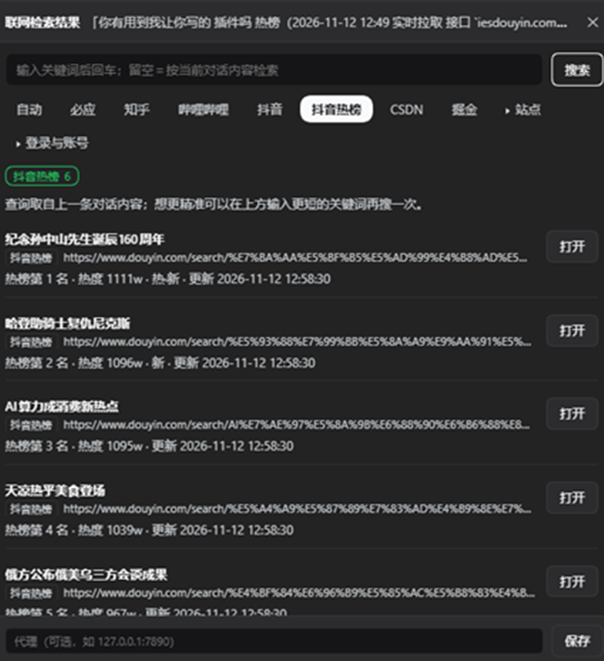
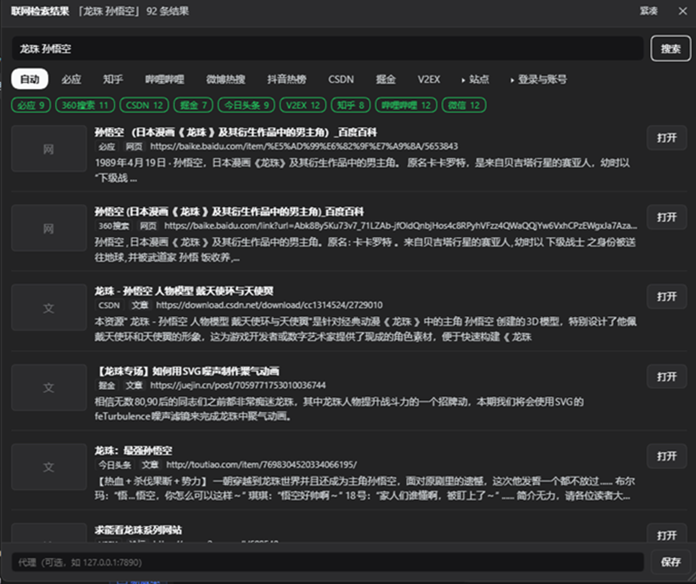
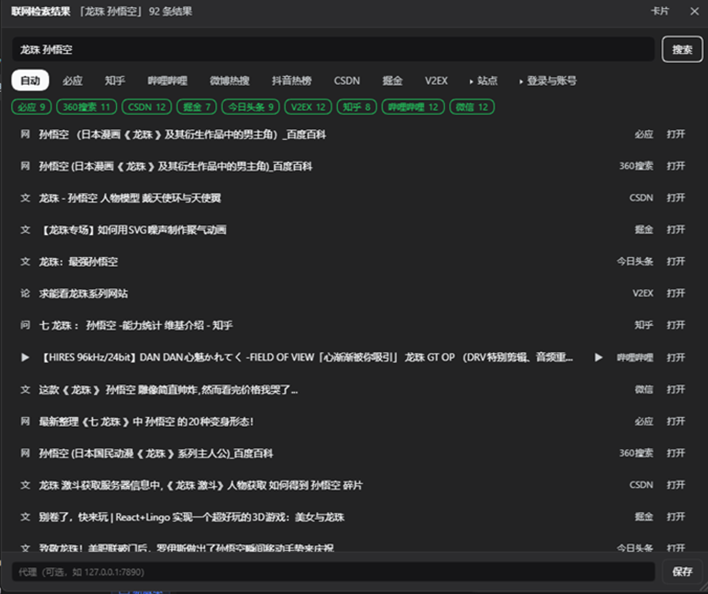
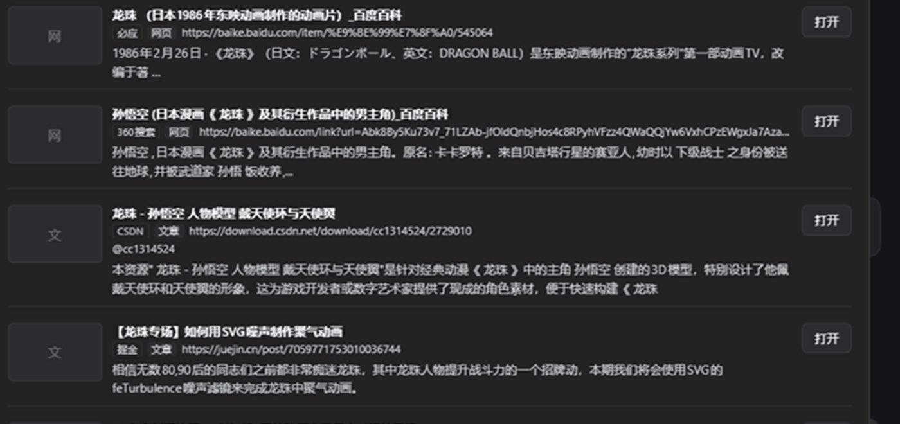
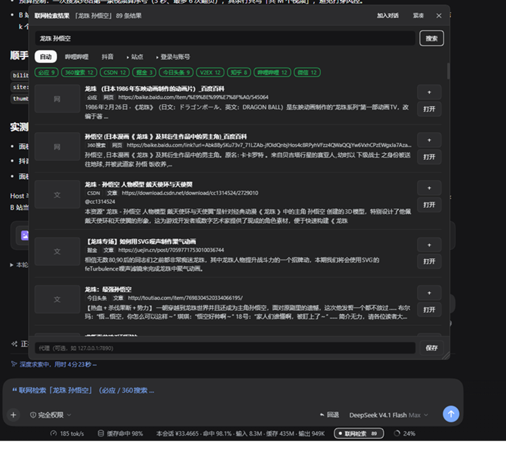
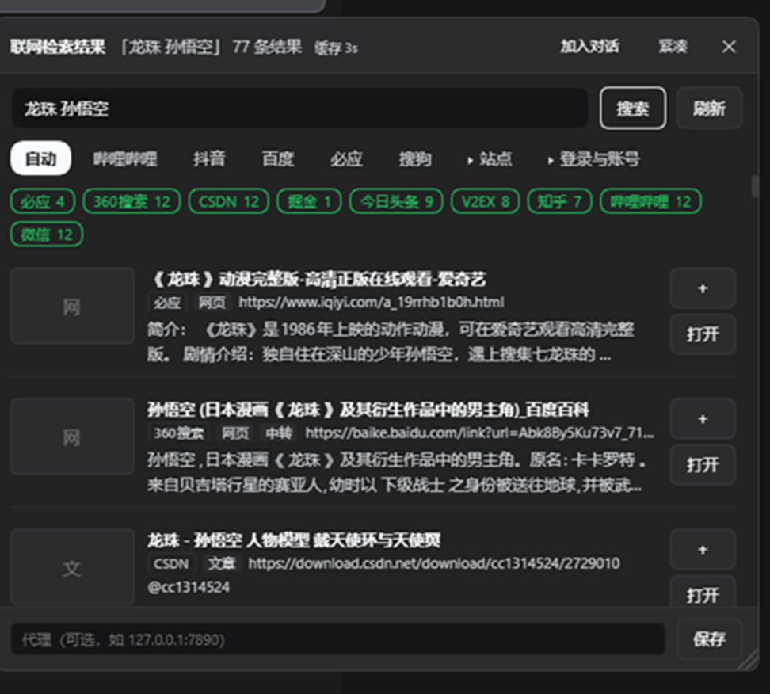
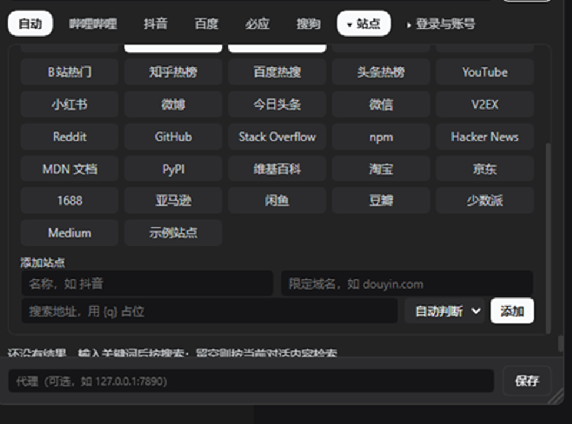
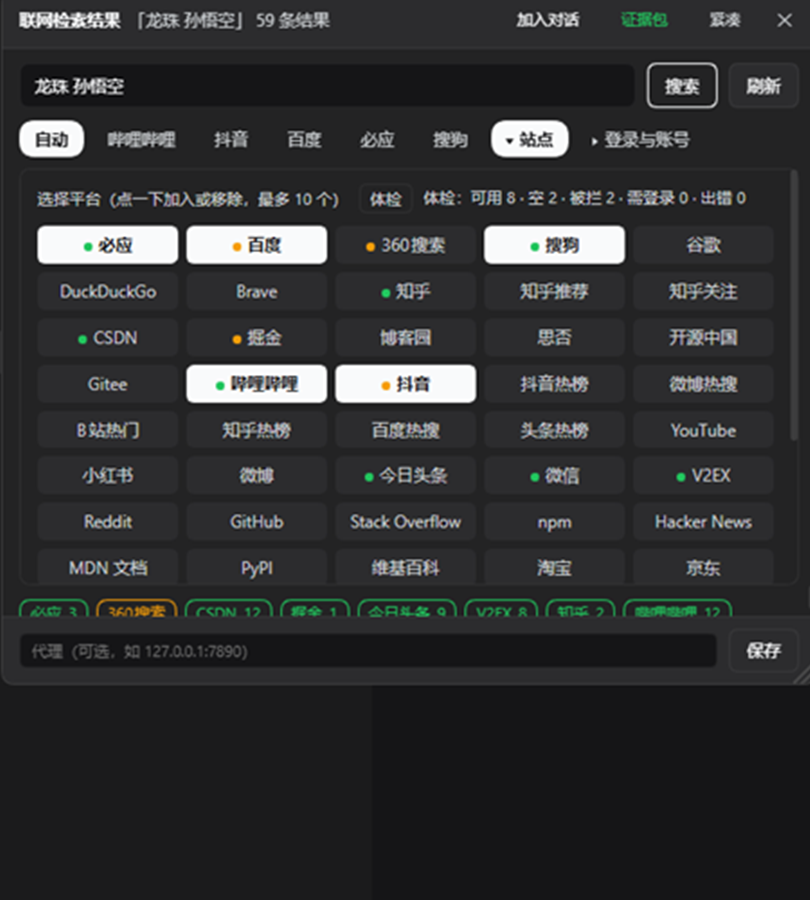
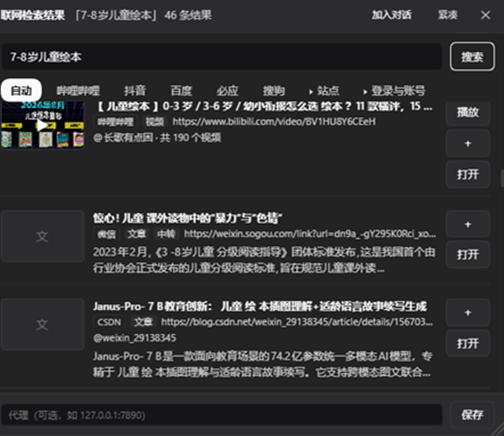

# dsh-web-scout · DeepSeek Harness 联网检索插件

> 对话里说的东西，插件替你去搜：46 个平台、8 个免关键词热榜、证据包、研究模式，还能当 MCP 服务用。
> Search the web from your chat: 46 platform backends, hot lists, evidence packs, research mode, and an MCP server.


## 它能做什么

- **挂件**：输入框下方多一个「联网检索」，点开面板搜；留空就用当前对话当查询。
- **给 Agent 的 6 个工具**：`web_scout_search` / `_open` / `_read` / `_evidence` / `_research` / `_health`。
- **HTTP**：`POST /web-scout/api`，本地脚本直接调。
- **MCP**：`node mcp/server.mjs`，Claude Desktop / Cursor 可用。

零 API Key、零运行时依赖（纯 Node，Node ≥ 22）。

| 检索结果与平台状态 | 热榜（不用输关键词） |
| --- | --- |
|  |  |

## 功能速览

- **46 个平台**：直连接口、`site:` 兜底、8 个热榜/信息流、自定义站点（填名称/域名/搜索地址即可）。
- **多页抓取**：`limit ≤30 × pages ≤4 × maxPlatforms ≤14`，默认 12×3×10，一次 70–90 条。
- **干净结果**：中文 2-gram 相关性过滤、跨源去重（剥 `utm_*`/`spm`/`from`）、落地页过滤、中转壳标「中转」。
- **登录态**：插件自带独立 profile 的浏览器，CDP 读 cookie；搜索与读正文都带你自己的登录态。
- **面板**：可拖动可缩放、十类卡片、B 站内嵌播放、缓存徽标与「刷新」。
- **缓存**：内存 LRU + SQLite（`~/.dsh/web-scout-cache.db`），`cacheTtlMs` 可配。
- **证据包 / 研究模式**：打分取前 N 条 + 摘录 + 覆盖与缺口；多轮检索带时间预算与质量门槛。
- **可插拔**：外部 provider 丢进 `<profile>/web-scout-providers/` 即生效，热加载。
- **导出与历史**：结果按相关度/平台排序，一键复制 Markdown / CSV；最近 20 条查询可点回重跑；Alt+W 随时开面板。
- **重排与熔断**：查询词重排（可插外部重排器），连续失败的平台自动跳过、冷却后自动恢复。
- **MCP 资源与提示词**：平台目录/体检历史/最近查询等 5 个资源、3 个提示词，工具调用带进度通知。
- **话题追踪**：盯一个查询词，后台按间隔重跑，每轮只回「没见过」的新链接（v1.25）。
- **浏览器渲染**：SPA / 要签名的站点用插件自管浏览器真渲染一次再抽结果，失败退回入口行（v1.26）。

更细的改动看 [CHANGELOG.md](CHANGELOG.md)，接口与字段看下面各节。

## 安装

### 前置

- DeepSeek Harness（桌面版即可），版本需支持 `plugin_manager` 的 bundle 安装。
- Node.js **≥ 22**（用到全局 `fetch`、`WebSocket`、`node:sqlite`）。
- 操作系统：Windows / macOS / Linux。登录用的浏览器是 Edge 或 Chrome（macOS 的 `/Applications`、Linux 的 `/usr/bin` 路径都已内置）。

### 方式 A：npm 一行装（推荐）

```bash
dsh plugin add dsh-web-scout
```

包名就是 `dsh-web-scout`（[npm](https://www.npmjs.com/package/dsh-web-scout)）。DSH 会把它当普通 bundle 装进当前 profile：`dependencies` 里出现 `"dsh-web-scout": "^1.22.0"`，`dsh.profile.bundles` 末尾多一项。

想装到指定 profile：`dsh plugin --profile <名字> add dsh-web-scout`。

### 方式 B：从本仓库装（开发用）

```bash
git clone https://github.com/tang-123-1/dsh-web-scout.git D:/dshcs/web-scout
```

```text
plugin_manager action=install_bundle target=D:/dshcs/web-scout
```

装完 profile 的 `package.json` 里是 `"dsh-web-scout": "link:D:/dshcs/web-scout"`。本包自带的 `cordis.patch.yml`（一行 `insert`，id `web-scout`）由安装器读取，**不要**手抄进 profile 的 `cordis.patch.yml`——同一个包出现在两个 Loader 源里会报 `resolves from multiple active Loader sources`，客户端半就永远加载不出来。

### 装完必做两件事

1. 让客户端半进入引导图（触发 Host 重新扫描 `dsh.client`）：
   ```text
   plugin_manager action=set_bundle target=dsh-web-scout enabled=false
   plugin_manager action=set_bundle target=dsh-web-scout enabled=true
   ```
   **跳过这步面板挂件不会出现。**
2. **刷新页面**（DevTools 里 `location.reload()`，或重启 DSH）。之后输入框下方应出现「联网检索」挂件。

### 验证

```text
POST http://127.0.0.1:3209/web-scout/api
{"op":"catalog"}
```

返回 `{"ok":true,...}` 且 `platforms` 长度为 46、`chips` 为 8 个默认芯片，就说明 Host 和客户端都已就绪。

离线验证（不启动 DSH，直接跑引擎）：

```bash
node scripts/smoke.mjs "cordis 插件"
```

## 使用

### 挂件

- 点「联网检索」打开面板；输入关键词回车，或直接点「搜索」（留空 = 用当前对话内容当查询）。
- 芯片行是平台选择：点一下加入、再点一下移除；「站点」分区里是所有平台的网格，还能新增任意站点（名称 / 限定域名 / 搜索地址，用 `{q}` 占位）；「登录与账号」分区管登录。
- 结果行左边的平台名来自后端标签，右边「打开」交给系统浏览器；服务端不可达的站点会单独列一块，每行一个「在浏览器打开」。
- 结果是卡片：左边缩略图（没有图就显示类型字形）、中间标题 + `平台` `类型` `URL` + 两行摘要、右边竖排按钮（视频类多一个「播放 / 收起」）。
- 结果上方的平台药丸可以点：只看那一个平台（标题变成 `9 / 92` 这种「当前 / 总数」），再点一次或点「全部平台」恢复。
- 标题栏 ✕ 左边是视图开关：`卡片` ↔ `紧凑`；紧凑视图一行一条（类型字形 + 标题 + 平台 + ▶ + 打开），选择记在 `localStorage` 里，刷新后还在。

### 卡片与内嵌播放（v1.9）

结果列表按站点类型渲染，类型来自三处（优先级从高到低）：

1. 平台定义里的 `kind`（内置平台用 `KIND_BY_ID`）；
2. 自定义站点自己填的「类型」（添加站点表单的第三个下拉，选 `auto` 就交给下一步）；
3. 域名/路径猜类型：`bilibili.com|youtube.com|/video/` → 视频，`zhihu.com|/question/` → 问答，`v2ex|reddit|/t/` → 论坛，`github|npm` → 代码，`taobao|jd` → 商品，`/hot` → 榜单，其余按平台分组兜底。

| 类型 | 中文标签 | 卡片表现 |
| --- | --- | --- |
| `video` | 视频 | 缩略图 + ▶ 遮罩；有 `embed` 时多一个「播放」 |
| `article` | 文章 | 缩略图（有就显示） |
| `qa` `forum` `hot` `shop` `code` `doc` `social` `web` | 问答 / 论坛 / 榜单 / 商品 / 代码 / 文档 / 动态 / 网页 | 类型标签 + 字形占位 |

内嵌播放只对返回 `embed` 的结果生效，目前是 **B 站**（`https://player.bilibili.com/player.html?bvid=…&autoplay=1`，服务端从 `x/web-interface/wbi/search/type` 的 `bvid` 拼出来）。抖音拿不到单条视频 URL（`site:douyin.com` 只回站内入口行，`aweme/v1/web/general/search` 需要 `a_bogus` 签名），所以抖音只有「打开」。

> 维护坑（v1.9 修过一次）：**B 站搜索接口是匿名的**。带上 store 里那套过期 `SESSDATA`/`buvid3` 会被判风控（`-412`/`-352`），两次重试都空 → 抛 `EngineBlocked` → 落到 `site:` 兜底，结果行就没有 `thumb`/`embed`，卡片既没图也不能播。所以 `backends.bilibili` 请求带了 `noCookies: true`（`net.js` 里 `init.noCookies === true` 时跳过 cookie jar）。


### 视图与筛选（v1.10）

- **平台筛选**：结果上方的每个平台药丸都是按钮，点一下只保留该平台的行，标题变成 `「查询」 9 / 92 条结果`，并出现 `只看 必应 · 全部平台` 提示行；再点同一颗药丸或点「全部平台」清除。筛选只影响展示，不重新请求。
- **卡片 / 紧凑**：标题栏的视图按钮在两种排版间切换。卡片视图有缩略图与两行摘要；紧凑视图一行一条，适合一次看几十条。当前视图写在 `localStorage["web-scout-view"]`。
- **无图也有字形**：没有缩略图的结果不再显示空框，而是在图位放该类型的淡色字形（网 / 文 / 问 / 论 / 热 / 购 / 码 / 档 / 动 / ▶）。





### 视频站点的作者与序号（v1.11）

视频类结果（哔哩哔哩、B 站热门）现在会带上「谁发的、这是他第几个视频」：

- 作者一行：卡片视图在 URL 行下面显示 `@作者`（可点，跳到作者主页），后面接 `第 k 个 / 共 M 个`、`4,221 赞`、`2025-01-08`；紧凑视图把这些压进 `平台 · @作者 · 共 M 个视频` 那一行。
- 序号怎么来的：`x/space/navnum?mid=` 拿作品总数 M，再在 `x/space/wbi/arc/search?order=pubdate` 的倒序分页上二分定位这条视频所在的页，`rank = M - 从最新数的位置`。一次搜索只给**第一条**视频算序号（预算 3 秒、最多 6 次翻页），其余行只写「共 M 个视频」——避免一次搜索打穿 B 站风控。
- B 站空间接口是按 IP 限流的：命中 `-412 / -352 / -799` 时插件会记 10 分钟禁用并自动降级为「共 M 个视频」，过一会儿或换网络会自动恢复出序号。
- 抖音改走**分享页**：`www.douyin.com` 的 `/discover`、`/hot`、`/video/<id>` 在服务端一律返回验证码中间页（`/discover` 还会 302 到 `/jingxuan`，就是你看到的「抖音精选版」）。所以插件把结果链接换成免验证码的 `https://www.iesdouyin.com/share/video/<id>/`；这条信息的作者/点赞/封面抖音只肯在前端渲染，服务端拿不到（需要 `a_bogus` 签名），因此抖音行只保证能在浏览器里正常播放。



### 把结果带进对话（v1.12）

检索完不用手抄，两步就能让对话基于这些结果写东西：

- 面板标题栏的 **加入对话**：把当前筛选出的前 8 条（标题 / 平台 / 类型 / 链接 / 摘要）拼成一段 Markdown，直接放进输入框；面板上会闪一行「已加入输入框，回车即可发送」。
- 每条结果右侧的 **＋**：只把这一条带进输入框，适合「就这条，帮我总结一下」。
- 放进输入框的内容长这样（第一行是来源与平台，末尾一句是给模型的指令）：

  ```text
  联网检索「龙珠 孙悟空」（必应 / 360搜索 / CSDN / 掘金 / 今日头条 / V2EX / 知乎 / 哔哩哔哩）的结果：

  1. 七龙珠 孙悟空VS贝吉塔
     哔哩哔哩 · 视频 · @消逝的天空L · 共 527 个视频
     https://www.bilibili.com/video/BV...
      ...
  请基于以上结果继续，需要时引用对应链接。
  ```

- 实现走的是宿主自己的输入框接口，按三档降级：`inputActions.insertQuote(text)`（插入成引用块）→ `inputActions.insertText(text, inputActions.captureInsertion())`（按修订号插入，可撤销）→ `inputActions.setDraft(text)`（直接覆盖草稿）。任一步成功就不再往下走，全失败会提示「输入框正忙」。
- 内容只放进输入框，**不会替你按回车**——想发就发，不想发删掉即可。



### 正文读取与缓存（v1.14）

搜索和读正文都走**两级缓存**，重复查询几乎零成本：

| 层 | 位置 | 命中耗时 | 说明 |
| --- | --- | --- | --- |
| 内存 LRU | 进程内，最多 240 条 | 约 1 ms | 同一会话反复搜同一个词 |
| SQLite | `~/.dsh/web-scout-cache.db`（WAL） | 约 2–4 ms | 重启 DSH 后仍然生效 |

- 默认 TTL 6 小时，可用配置项 `cacheTtlMs` 调（60 秒 – 24 小时）。
- 缓存键包含查询词、平台列表、条数、页数、代理设置，所以换代理/换条数不会命中同一份结果。
- 面板上命中缓存时标题会多一个**「缓存 3s」**徽标（3s = 这份结果存在了 3 秒）；旁边的**刷新**按钮会绕过缓存重新联网。
- 工具调用同理：`web_scout_search` 传 `refresh: true` 可强制刷新；`web_scout_read` 抓过的正文再次读是毫秒级。
- 缓存坏了不会影响搜索：SQLite 打不开时自动退化成纯内存（`cache.stats` 里 `persistent:false` 会显示原因）。
- 维护接口：`POST /web-scout/api {"op":"cache.stats"}` 看命中数/行数/文件路径；`{"op":"cache.clear"}` 清空。



### 可插拔 Provider（v1.15）

后端不再写死在 `engines.js` 里。每个站点就是一个 provider 对象，内置的 46 个和外部的一样走同一个接口：

```js
// <DSH profile>/web-scout-providers/mysite.mjs
export default {
  id: 'mysite',                 // 小写，可含 . _ -
  label: '我的站点',             // 面板里显示的名字
  kind: 'article',              // video/article/qa/forum/hot/shop/code/doc/social/web
  site: 'example.com',          // 可选：没有 search 时用它走 site: 兜底
  browser: (q) => `https://example.com/search?q=${encodeURIComponent(q)}`,
  async search({ query, limit, client, timeoutMs, page }) {
    // 返回 [{ title, url, snippet, extra?, thumb?, embed? }]
    return [{ title: `${query} 的结果`, url: 'https://example.com/a', snippet: '……' }];
  },
};
```

放进 `<DSH profile>/web-scout-providers/`（Windows 上是 `C:\Users\<你>\.dsh\profiles\desktop\web-scout-providers\`），然后：

```bash
curl -s -X POST http://127.0.0.1:3209/web-scout/api -H "content-type: application/json" \
  -d '{"op":"provider.reload"}'
```

它立刻出现在面板「站点」网格与 `catalog.platforms`（`source:"external"`）里，也能直接 `{"op":"search","platforms":["mysite"]}`。

| 能力 | 说明 |
| --- | --- |
| 静态校验 | id / label / search 或 browser 缺失、kind 非法、id 重复都会被拒，错误记进 `provider.reload.errors`，**不会影响插件其它功能** |
| 热加载 | 每次 reload 带 `?v=<时间戳>`，改完文件刷新就生效，不用重启 Host |
| 隔离 | 单个文件语法错误、抛异常、超过 256 KB、目录读不了，都只丢这一条 |
| 来源标记 | `provider.list` 里每个 provider 带 `source: builtin / external / custom`，面板与 catalog 同步显示 |
| 安全边界 | 只用 Node 原生 `import`，不执行安装脚本，不联网下载代码——文件是你自己放的 |

内置 provider 仍然转调原来的后端函数（`BACKENDS[id]`），所以 v1.14 的行为、翻页、缓存、过滤全部不变；`_probe/verify-providers.mjs` 里有一条「provider 与直接调后端结果完全一致」的等价性断言。



### MCP 服务（v1.16）

除了 DSH 内部使用，web-scout 还能作为标准 **MCP 服务**被任意宿主调用（Claude Desktop、Cursor、你自己的脚本、CI）。零依赖，只用 Node 内置能力，协议层是手写的 JSON-RPC 2.0 over stdio。

```bash
node <仓库路径>/mcp/server.mjs          # 直接跑（stdio 就是协议通道，日志走 stderr）
node <仓库路径>/mcp/server.mjs --help   # 看支持的工具
```

在宿主的 MCP 配置里加一段即可：

```json
{
  "mcpServers": {
    "web-scout": {
      "command": "node",
      "args": ["D:/dshcs/web-scout/mcp/server.mjs"],
      "env": {}
    }
  }
}
```

| 工具 | 参数 | 返回 |
| --- | --- | --- |
| `web_scout_search` | `query`（榜单类可空）、`platforms`、`limit`、`pages`、`timeoutMs`、`refresh` | `content[].text` 人读清单 + `structuredContent`（`query/platforms/results/cached/cacheAgeMs`） |
| `web_scout_read` | `url`、`maxChars` | 标题、状态码、字数、是否截断、正文、缓存命中 |
| `web_scout_providers` | 无 | 平台 / provider 清单、默认源、代理、缓存 TTL |
| `web_scout_evidence` | `query`（榜单可空）、`platforms`、`budgetChars`、`maxItems`、`perPlatform`、`excerptChars`、`refresh` | 证据包：选中条目 + 摘录 + 覆盖面 + 缺口 + 纯文本 |
| `web_scout_health` | `platforms`、`query`、`timeoutMs`、`deep` | 连通性体检：每站状态 / 耗时 / 可用性 + 汇总文本 |

设计要点：

- **共享配置与缓存**：MCP 服务读的是同一份 `~/.dsh/web-scout.json`，缓存也是同一个 `web-scout-cache.db`（SQLite WAL，多进程安全）。面板里搜过的词，MCP 侧再搜是毫秒级命中；反之亦然。
- **共享 provider**：外部 provider（`<profile>/web-scout-providers/*.mjs`）会自动加载，MCP 里 `platforms:["mysite"]` 直接可用。
- **协议兼容**：支持 MCP `2025-06-18` / `2025-03-26` / `2024-11-05`；客户端报新版本就回新版本，报不认识的版本回落 `2024-11-05`。传输同时吃换行分隔 JSON（MCP 官方 stdio）和 LSP 式 `Content-Length` 帧。
- **不会被脏输入打死**：坏 JSON 回 `-32700` 后继续服务；未知方法回 `-32601`；工具报错用 `isError:true` 包住，进程不退出；stdin 关闭才 `exit 0`。
- **stdout 只走协议**：所有诊断日志写 stderr，避免把宿主解析器搞崩（验收里有一条专门断言）。

验收脚本（都在 `_probe/`，可直接 `node` 跑）：

| 脚本 | 覆盖 | 结果 |
| --- | --- | --- |
| `verify-mcp.mjs` | 握手/版本协商、tools/list、搜索、二次缓存命中、refresh、正文缓存、错误路径、榜单空 query | 24/24 |
| `verify-mcp-robust.mjs` | 并发流水线 id 对齐、stdout 纯 JSON、批量数组、坏 JSON 后存活、stdin 关闭 exit 0、Content-Length 帧 | 10/10 |
| `verify-mcp-tools.mjs` | 外部 provider 可搜、未知平台回落默认源、`timeoutMs` 钳位、不可达域名 isError | 7/7 |
| `verify-evidence.mjs` | 去重、打分排序、每平台配额、预算、摘录命中、缺口、榜单空 query、新鲜度、体检跳过规则 | 19/19 |
| `verify-evidence-live.mjs` | live 证据包预算/缓存/榜单、体检三站真打、未知平台 skipped | 15/15 |
| `verify-mcp-117.mjs` | MCP 侧五个工具、证据包预算与缓存、体检、缺 query isError | 11/11 |

### MCP 资源与提示词（v1.31）

MCP 服务不再只有 7 个工具：宿主可以直接把平台目录、体检历史、最近查询、设置和追踪列表当**资源**读，也可以拿现成的**提示词**把一个模糊请求变成一次明确的检索。

**资源**（`resources/list` + `resources/read`，全部 `application/json`）
- `web-scout://platforms`：平台目录（id、中文名、kind、是否榜单、是否需要登录、站内搜索地址）。
- `web-scout://health`：每个平台最近 50 次体检记录、成功率、平均耗时与 20 段色条序列。
- `web-scout://recent`：最近 20 次检索（7 天 TTL）。
- `web-scout://config`：当前设置（代理等敏感字段已脱敏）。
- `web-scout://watches`：话题追踪列表，含最近一次新增数与下次到期时间。
- 模板 `web-scout://platform/{id}`：单个平台的目录信息 + 体检历史 + 熔断状态，例如 `web-scout://platform/gitee`。未知资源回 `-32602` 并说明原因。

**提示词**（`prompts/list` + `prompts/get`）
- `research_topic(topic, angle?, depth?)`：`quick` 走 3 秒预算单轮，`deep` 走 20 秒三轮；要求按「结论 → 证据 → 缺口」回答，且只引用返回里的原文引文。
- `platform_sweep(topic, platforms?)`：多平台横评，明确要求把 `skipped`（熔断中，剩余 N 分钟）和需要登录的平台写出来，不许把空结果当成「没有」。
- `watch_topic(topic, everyMinutes?)`：建一个追踪并立刻跑首轮（首轮 `added=0` 是建立基线，正常）。

**进度通知**
- `tools/call` 收到 `_meta.progressToken` 时会发 `notifications/progress`（开始 `0`、结束 `1`，失败也发 `1` 并带失败原因），长任务在宿主侧不再是一片空白。

### 重排与熔断（v1.30）

两件事都在同一个地方控制：面板底部那行「重排 / 熔断」，也可以直接改设置（`config` 的 `rerank` / `breaker`）。

**重排**（`rerank`，默认 `lexical`）
- `off`：保持各平台原始顺序。
- `lexical`：按查询词在标题、摘要、地址里的命中程度重排，命中越靠前、越集中越靠前；原分数只作小幅加权，不会让「分数高但不相关」的结果压住真正相关的。
- 外部重排器：把 `*.mjs` 放进 `<profile>/web-scout-rerankers/`（`rerank.list` 会打印实际目录），文件导出 `{ id, rank(items, ctx) }` 即可；`rank` 抛错或返回长度不一致时自动退回 `lexical`，错误写进 `data.rerank.errors`，不会让整次检索失败。最多加载 20 个、单文件 128KB。
- 每次检索都会带 `data.rerank = { mode, used, moved, errors }`，`moved` 是被挪动过位置的条数。

**熔断**（`breaker`，默认开）
- 某平台最近 3 次（`breakerThreshold`）体检/检索都是 `error` / `timeout` / `blocked`，就先跳过它；`empty`（真没结果）和 `login`（需要登录）不算坏，不会误伤。
- 冷却 30 分钟（`breakerCooldownMs`）后自动放行一次再试，成功即恢复。
- 被跳过的平台仍会出现在结果的 `platforms` 里，`status: 'skipped'`、`backend: 'breaker'`，`note` 写明还剩几分钟；不知道原因时看 `health.breaker`（列出 `fails` / `retryInMs` / `reason`）。
- 想立刻重试：`health.resume`（单平台或全部清空），或在这次请求里传 `breaker: false` 强制打一遍。
- 全平台都在冷却时不会静默返回空，而是直接报错并说明怎么解。

### 结果操作与导出（v1.29）

检索结果是拿来用的，不是拿来看的。面板标题栏右侧多了三样：

- **排序**：相关度 ↔ 平台。按平台时会先按平台名排，同平台内仍按相关度降序——想「把知乎的都挑出来看」不用再一个个点药丸。
- **复制 Markdown**：`## 查询（N 条）` 标题 + 编号列表，每条是 `[标题](地址) — 平台 · 类型` 加一行压平后的摘要；标题里的方括号会被替换掉，粘进文档不会把链接语法弄坏。
- **复制 CSV**：`序号,标题,平台,地址,摘要` 五列，字段一律加引号、内部引号翻倍、摘要里的换行压成空格，Excel/Numbers 直接开。

输入框下面多一行「最近」：最近 7 天、最多 20 条查询，点一下就用当前选中的平台重跑，`+N` 展开更多，`清空` 一次抹掉。历史落在插件配置里（`recent`），重启 DSH 仍在；同一查询不重复记，只把时间刷新到最前。

面板关闭时按 **Alt+W** 直接打开并聚焦输入框（不抢 Ctrl/⌘ 组合键），开着时再按一次只是重新聚焦。

```jsonc
{"op":"recent.list"}    // → {recent:[{q,platforms,at}],ttlDays:7,limit:20}
{"op":"recent.clear"}   // 清空历史
{"op":"search","query":"宣传文案","remember":false}   // 只搜不记
```

### 平台体检历史（v1.28）

体检原来是一次性的：点完看到一排圆点，关掉就没了。现在每次体检都会落盘，面板上能看出「这个平台最近一直不稳」还是「只是刚才抖了一下」：

- 每平台保留最近 **50 次**记录（`{at, status, ms}`），成功率与平均耗时按**最近 20 次**算（平均耗时只统计成功的那几次，别让超时把均值拉爆）。
- 平台网格里，平台名后面多一条 2px 宽的色条：绿=可用、黄=空结果、红=失败/需登录；右侧圆点仍是「这一次」的状态。
- 悬停标题里带「成功率 67% · 平均 400ms · 最近 3 次」。
- `health.check` 默认记，`remember:false` 只体检不落盘；`health.history` 读统计，`health.forget` 清一个或全部。
- 配置文件里坏掉的条目（状态乱写、缺时间、不是数组）在加载时就被丢掉，不会把面板画崩。

```jsonc
{"op":"health.check","platforms":["bing","zhihu"]}      // 体检并记录
{"op":"health.history","platforms":["bing"]}            // → rows:[{id,label,samples,okRate,avgMs,lastAt,lastStatus,series}]
{"op":"health.forget","platform":"zhihu"}               // 清一个；不传 platform 清全部
```

实测：真体检一次 bing 记下 `{status:"ok",ms:715}`，`health.history` 立刻读到 `samples:1 / okRate:1 / avgMs:715`。

### 原文引文（v1.27）

证据包原来只给「标题 + 摘要」，摘要常常是站点自己截的，核对起来还得点进去。现在会给前几条补一句**原文里真的有**的话：

- 对排名前 `quotePages`（默认 3）条抓正文，切句后只保留**命中查询词**的句子，挑 1–2 句拼成引文；引用文本能在原文里 grep 到，不是模型转述。
- 挑不到就留空——宁可这条没有引文，也不编一句像样的。
- 噪声先剔：导航（首页/登录/注册/关于我们）、cookie 提示、过短的行；同一句重复出现只算一次。
- 中文一句话 12 字即可入选，英文要 24 字符（避免抽到半句）。
- 抓正文失败不影响其它条：`quoteStats.errors` 里记 URL 与原因，证据包照常返回。
- `quotes:false` 完全关掉这一层，回到「只要摘要」的旧行为。

```jsonc
{"op":"evidence","query":"cordis 插件","quotePages":2}
// → items[].quote / items[].quoteHits, quoteStats:{attempted,fetched,withQuote,skipped,tookMs,errors}
```

实测：「cordis 插件」在 bing 上 3 条结果、抓 2 篇正文、1 条拿到引文，718ms；引文与原文逐字一致（忽略标点/空白）。

### 浏览器渲染抓取（v1.26）

有一批站点只对真浏览器给内容：搜索页是 SPA、接口要签名、或者要过一遍 JS 才出结果。以前它们只会回一条「去站内搜」的入口行，现在会先用插件自管的浏览器真渲染一次：

- **复用同一个浏览器**：和「登录态」用的是同一个 profile（`<profile>/web-scout-browser`），cookie 一致，你在浏览器里登录过的站点渲染时就是登录态。
- **临时标签**：渲染开一个临时标签，取完 DOM 立刻关掉，不动你自己开着的标签。
- **预算**：一次搜索最多渲染 `renderPages`（默认 2）个 entryOnly 平台，总耗时封顶 `renderBudgetMs`（默认 16s）；超预算/失败就退回入口行，不会拖慢整个搜索。
- **稳定性判定**：等 `load` 之后再看正文长度，连续两次不变才取 HTML（SPA 的结果常在 load 之后才填进来）。
- **只回相关的**：渲染出来的锚点先剔掉登录/注册/站内搜索页/当前页，再按查询词（标题或 URL slug）过滤；宁可空着退回入口，也不把「关于我们」当结果。

```jsonc
{"op":"render.check"}                       // → {available, browser, running, enabled, renderPages}
{"op":"render.check","url":"https://search.gitee.com/?q=cordis"}  // 真渲染一次，回 htmlChars/anchors/tookMs
// 配置：{"render":true,"renderPages":2,"renderBudgetMs":16000,"renderHeadless":false}
```

实测（2026-11-17）：Gitee 站内搜索从「只有入口行」变成 10 条真实仓库结果，约 2.3s；博客园现在要拖滑块验证，渲染能出 HTML 但抽不到结果，于是干净地退回入口行并在 `note` 里说明原因。

没装 Edge/Chrome 时这一层自动跳过（`available:false`），行为与旧版一致。

### 话题追踪（v1.25）

同一个话题看第二遍时，你想要的是「这几小时又出了什么」，而不是把同一批结果再过一遍。追踪（watch）就是把这个差集记下来：

- **去重键**：URL 去掉 `#fragment` 与 `utm_*`/`spm`/`from`/`source`/`ref`/`scene` 参数后小写比对，同一篇文章挂不同追踪参数只算一条。
- **基线**：第一次运行只建基线（`added=0, first=true`），不会把整页结果当「新增」砸给你。
- **调度**：宿主每分钟检查一次，到期的才跑，一次最多 4 个；`everyMinutes` 10–1440，最多 12 个 watch。
- **落盘**：`web-scout.json` 的 `watches` 字段（含 `seen` 基线，最多 400 条 URL），写穿到磁盘，重启不丢。
- **面板**：挂件底部「追踪」→ 填关键词 + 间隔 → 添加；每行有上次运行时间、新增条数、运行/删除。

```jsonc
{"op":"watch.add","query":"cordis 插件","platforms":["bing","csdn"],"everyMinutes":60,"run":true}
{"op":"watch.list"}                       // → watches[]（dueInMs 告诉你还有多久到期）
{"op":"watch.run","id":"w..."}            // → added / total / items[]（只含新增）
{"op":"watch.run"}                        // 不带 id：把当前到期的都跑一遍
{"op":"watch.remove","id":"w..."}         // 或 {"op":"watch.clear"}
```

Agent 侧是 `web_scout_watch`，MCP 侧也是 `web_scout_watch`（同一套 action）。

### 证据包（v1.17）

「搜到 90 条」和「模型能用」是两件事。证据包把结果压成一段可引用的材料：

- 打分：`0.42 × 标题命中 + 0.22 × 摘要命中 + 0.16 × 原排名 + 0.12 × 后端质量 + 0.08 × 新鲜度`（原排名按名次线性衰减，后端质量按 原生接口 1 / 自定义 0.7 / 站内兜底 0.6 / 榜单 0.55）。
- 配额与预算：每平台最多 `perPlatform` 条（默认 3），总字符预算 `budgetChars`（默认 6000，`usedChars` 会回传），超预算的进 `dropped.budget`。
- 摘录：从正文/摘要里挑**含查询词**的那一句（切句后按 token 命中 + 中文 2-gram 覆盖打分），长度 `excerptChars`（默认 240）。
- 缺口：`gaps` 说明哪些类型没覆盖到（比如没有视频类结果），`platformNotes` 记录各平台为什么没贡献。

```jsonc
// 面板：标题栏「证据包」→ 直接放进输入框；接口：
{"op":"evidence","query":"cordis 插件","platforms":["csdn","v2ex"],"budgetChars":1500}
```


### 连通性体检（v1.17）

站点会时不时被风控（360 人机验证、百度安全验证、B 站 -412），体检让你先看清哪条通道现在是通的：

- 原生后端（provider / `def.backend` / 自定义站点）用小样本真打一次（`limit:2`），判 `ok` / `empty` / `blocked` / `login` / `error`，并记耗时。
- 纯 `site:` 兜底平台默认跳过（`skipped: site-fallback`），加 `deep:true` 才真去打搜索引擎；不存在的 id 记 `skipped: unknown`。
- 并发默认 4，`timeoutMs` 默认 8000；返回 `tally` 汇总与 `text` 人读版本。

```jsonc
{"op":"health.check","platforms":["csdn","v2ex","bing"],"timeoutMs":9000}
```

面板里：站点分区 → 「体检」→ 每个平台前面出现状态点（绿=可用，黄=空/被拦/需登录，红=出错），悬停看耗时与原因。



### 查询规划与研究模式（v1.18）

一个问题往往不是一个查询词能解决的。规划器先判断意图、改写查询、挑平台，研究模式再按波次打，够了就停：

- **意图路由**：代码/报错 → GitHub、Stack Overflow、CSDN、掘金；文档/API → GitHub、Stack Overflow、CSDN、MDN；论文/研究 → Wikipedia、Stack Exchange、知乎；新闻/热榜 → 头条、微博热搜、百度热搜；教程/怎么做 → 知乎、CSDN、掘金、B 站；对比/选型 → 知乎、V2EX、CSDN；商品/价格 → 淘宝、京东、闲鱼；其余走通用。
- **查询变体**：原始查询 → 中文技术词转英文（插件→plugin、报错→error…共 36 条）→ 查询里带域名时补 `site:` → 代码/文件名 token 加引号。最多 4 个，逐个去重。
- **波次**：主平台（前 4 个）→ 换说法再来一轮（前 3 个）→ 剩余平台补漏；每波前先看时间预算，剩余不足 1.5 s 直接记 `skipped: budget`。
- **质量门槛**：每波用证据包评估 `items >= minItems && 平台数 >= quorumPlatforms && 类型数 >= quorumKinds`，达标立刻停，不浪费请求。

```jsonc
// 面板：标题栏「研究」→ 报告直接进输入框
{"op":"plan","query":"cordis 插件报错 403"}
// → intent: "code"，platforms: ["github","stackoverflow","csdn","juejin"]，variants: 原始 + plugin/error

{"op":"research","query":"cordis 插件","platforms":["csdn","v2ex"],"budgetMs":15000,
 "minItems":6,"quorumPlatforms":3,"quorumKinds":2}
// → rounds[{added,total,platformsHit,kinds,met,took}], quality, pack, text（研究报告）
```

报告＝证据包正文（评分摘录 + 覆盖面 + 缺口）＋三行机器可读的「规划 / 检索 / 质量」。
只选榜单类平台时可以不填查询词；关键词检索仍然必须给 `query`。

### 六个工具（Agent 侧）

| 工具 | 参数 | 用途 |
| --- | --- | --- |
| `web_scout_search` | `query?` `platforms?` `limit?` `pages?` `timeoutMs?` `context?` `open?` | 检索；`query` 省略时按对话内容推断 |
| `web_scout_open` | `url?` `platform?` `query?` | 用系统浏览器打开结果或该站的搜索页 |
| `web_scout_read` | `url` `maxChars?` | 抓正文（返回标题、正文、状态码、页内链接） |
| `web_scout_evidence` | `query?` `platforms?` `budgetChars?` `maxItems?` `perPlatform?` `excerptChars?` `limit?` `pages?` `refresh?` | 证据包：评分摘录 + 覆盖面 + 缺口，直接喂模型 |
| `web_scout_health` | `platforms?` `query?` `timeoutMs?` `deep?` | 连通性体检：哪些站现在能用、哪些被拦/需登录 |
| `web_scout_research` | `query?` `platforms?` `budgetMs?` `maxRounds?` `minItems?` `quorumPlatforms?` `quorumKinds?` `limit?` `pages?` `refresh?` | 研究模式：规划 → 多波检索 → 质量门槛 → 研究报告 |

### HTTP 接口

`POST http://127.0.0.1:3209/web-scout/api`，请求体 `{"op":"...", ...}`：

| op | 主要参数 | 说明 |
| --- | --- | --- |
| `catalog` | — | 平台清单 + 当前配置 + 芯片 + 登录状态 |
| `search` | `query?` `platforms?` `limit?` `pages?` `context?` `sessionId?` `open?` `refresh?` | 检索并记录历史；命中缓存直接返回（`refresh:true` 强制重新联网） |
| `read` | `url` `maxChars?` | 抓网页正文（同样走缓存） |
| `cache.stats` / `cache.clear` | — | 缓存统计（命中数/行数/字节/文件）/ 清空缓存 |
| `provider.list` / `provider.reload` | — | provider 清单（含来源）/ 重新加载外部 provider 目录 |
| `open` | `url?` `platform?` `query?` | 系统浏览器打开 |
| `config` | `patch:{}` | 改代理 / 条数 / 默认平台等 |
| `chips` | `chips:[]` | 保存芯片条 |
| `platform.add` / `platform.remove` | `{name,url,site}` / `{id\|name}` | 自定义站点 |
| `login.open` `login.browser` `login.capture` `login.paste` `login.check` `login.clear` `login.status` | `platform` | 登录相关（见下） |
| `browser.status` | — | 插件自管浏览器状态 |
| `graph` | — | 自检：客户端包是否已进入 `__DSH_BOOT__` |

## 平台与后端

**直连后端**（不经过搜索引擎，直接拿站内数据）：

| 平台 | 后端 | 翻页 | 备注 |
| --- | --- | --- | --- |
| 必应 | `bing` | ✗ | HTML 解析，恒定 10 条 |
| 百度 | `baidu` | `pn` | 反爬较凶，失败会降级为浏览器入口；真链接取容器上的 `mu` 属性，不是 `link?url=` 中转壳 |
| 360搜索 | `so360` | `pn` | 结果真链接在 `data-mdurl` |
| 搜狗 | `sogou` | ✗ | 同上，验证码会降级 |
| 谷歌 / DuckDuckGo / Brave | `google` / `ddg` / `brave` | — | 需要代理，否则直接给浏览器入口 |
| CSDN | `csdn` | `p` | JSON 接口 |
| 掘金 | `juejin` | `cursor` | POST + 游标，19 条/页 |
| 哔哩哔哩 | `bilibili` | `page` | WBI 签名，两字关键词有“猜词”问题已被相关性过滤挡住 |
| 知乎 | `site:zhihu.com` | — | 登录后可用 `/api/v3/feed` 读首页（本插件只做检索） |
| 今日头条 | `toutiao` | ✗ | 解析 SSR 页面里的 `<script type="application/json">` |
| V2EX | `v2ex` | `from` | `sov2ex` 接口 |
| 微信 | `weixin` | `page` | 搜狗微信，抓公众号文章标题/摘要/账号；链接是搜狗中转壳（`/link?url=`），面板上标「中转」 |
| 抖音热榜 | `douyin-hot` | ✗ | 榜单，不需要关键词，50 条 |
| 微博热搜 | `weibo-hot` | ✗ | `weibo.com/ajax/side/hotSearch`，50 条，带热度与「热/新/沸」标签 |
| B站热门 | `bili-hot` | ✗ | `ranking/v2` 排行榜，100 条，带播放/点赞/UP 主 |
| 知乎热榜 | `zhihu-hot` | ✗ | `/api/v3/feed/topstory/hot-lists/total`，30 条，**需要登录** |
| 百度热搜 | `baidu-hot` | ✗ | `top.baidu.com/api/board`，实时榜 |
| 头条热榜 | `toutiao-hot` | ✗ | `hot-event/hot-board`，50 条，带热度与榜单位次 |
| 知乎推荐 | `zhihu-recommend` | `page_number` | **需要登录**；首页推荐流，6 条/页 |
| 知乎关注 | `zhihu-follow` | `page_number` | **需要登录**；关注流，6 条/页 |
| GitHub / Stack Overflow / npm / Hacker News / 维基百科 | 各自接口 | `page` | Stack Overflow 与维基需要代理 |
| MDN 文档 | `developer.mozilla.org/api/v1/search` | - | 官方搜索 API，`documents[]` 带 `mdn_url`/`summary` |
| 豆瓣 | `movie.douban.com/j/subject_suggest` | - | 联想接口免登录，返回影视/书目 + 海报 |
| 思否 | `segmentfault.com/search` | `page` | 服务端渲染，抓 `<a href="/a/ID"><h5>标题` |

**站内检索**（`site:` 双引擎兜底，带域名校验、过滤首页）：知乎、博客园、开源中国、Gitee、抖音、小红书、微博、Reddit、PyPI、淘宝、京东、1688、亚马逊、闲鱼、少数派、Medium、YouTube。

> 加新平台的成本：能直连就在 `engines.js` 的 `BACKENDS` 里加一个 `async (ctx) => rows`，再在 `PLATFORM_LIST` 里挂 `backend`；不能直连就在 `PLATFORM_LIST` 里给个 `site` + `browser(q)`，其余全部自动生效（翻页、去重、过滤、状态药丸都不用管）。

### 空壳结果过滤（v1.13）

搜索结果里有两类「看着有、点开没有」的行，v1.13 起分开处理：

| 类型 | 表现 | 处理 |
| --- | --- | --- |
| 中转壳 | 链接是搜索引擎自己的跳转（`baidu.com/link?url=`、`sogou.com/link?url=`、`weixin.sogou.com/link?url=`） | **保留**（点开能跳到正文），URL 行标一个「中转」小标签；百度改为直接读容器上的 `mu` 属性取真地址，离线复解析 19/19 条可还原 |
| 空条目 | 标题等于查询、标题是「…的最新相关信息」这类占位、链接是引擎自己的结果页（`/s?wd=`） | **丢弃**，平台状态里记「滤掉 N 条空壳」 |

抓到了内容但一条都不相关时（典型场景：搜索引擎把 `7-8岁儿童绘本` 当成 `7`，整页返回 7-Zip），状态显示「抓到的 N 条都不含查询词，已过滤」，而不是含糊的"没结果"。

中文相关性判定改用 2-gram 覆盖率（≥0.5 通过）而不是整串包含：必应会把中文标题切出空格（`7-8 岁儿童绘本`），整串比对会把正常结果全部误杀。



### 榜单与信息流（v1.7 / v1.8）

八个平台不消费关键词——选中它们、输入框留空直接搜，拿到的就是当前榜单/信息流。面板检测到「选中项全是这类平台」时，输入框提示会变成「榜单/信息流：不用输关键词，直接点搜索」。

| 平台 | 后端 | 需要登录 | 条数 | 带什么 |
| --- | --- | --- | --- | --- |
| 抖音热榜 | `douyin-hot` | ✗ | 50 | 排名、热度、标签位 |
| 微博热搜 | `weibo-hot` | ✗ | 50 | 排名、热度、热/新/沸 |
| B站热门 | `bili-hot` | ✗ | 100 | 排名、播放、点赞、UP 主 |
| 知乎热榜 | `zhihu-hot` | **是** | 30 | 排名、回答数、关注数 |
| 百度热搜 | `baidu-hot` | ✗ | 实时榜 | 排名、词条链接 |
| 头条热榜 | `toutiao-hot` | ✗ | 50 | 排名、热度、榜单位次 |
| 知乎推荐 / 知乎关注 | `zhihu-recommend` / `zhihu-follow` | **是** | 6/页 | 作者、赞数、评论、日期 |

- 抖音热榜：`iesdouyin` 榜单接口，50 条，带排名/热度/标签位。
- 知乎推荐 / 知乎关注：`/api/v3/feed/topstory*`，6 条/页，`pages` 控制翻几页。**必须先登录知乎**，否则状态药丸会显示「需要登录：还没登录知乎…」。
- 这八个平台不在默认 9 源里（混进关键词检索会全是噪音），需要时在「站点」分区里点一下加到芯片条；榜单是实时抓取，刷新面板就是最新榜。
- 只选信息流平台时，插件不会把对话内容硬塞成查询词（`feedOnly` 分支），API 用 `{"op":"search","platforms":["zhihufollow"]}` 即可。

### 热榜趋势与跨榜共振（v1.21）

榜单类平台（抖音热榜 / 微博热搜 / B站热门 / 知乎热榜 / 百度热搜 / 头条热榜 / 知乎推荐 · 关注）每次抓取都会存一份快照（最近 8 个平台、每平台 60 行，写在 `~/.dsh/web-scout.json` 的 `hotSnapshot`），下一次抓取就能算出：

| 字段 | 含义 |
| --- | --- |
| `extra.trend.isNew` | 上一次快照里没有这条 → 新上榜 |
| `extra.trend.rankDelta` | 名次变化，正数是上升（`↑3`），负数是下滑（`↓2`） |
| `extra.trend.hotDelta` | 热度变化（万为单位） |
| `extra.resonance` | 同一话题还出现在哪些榜单里（2-gram 命中 ≥2 判同题） |

面板上：新上榜是黄色「新」，上升绿色 `↑n`，下滑灰色 `↓n`，跨榜同题显示「共振×n」；「加入对话」生成的文本也带这些标记，模型能直接看出话题在爬升还是在退烧。

实测（同一批三个榜单连打两次）：微博热搜 `fresh=1 moved=3`；「2027研究生报考人数」同时出现在微博热搜与抖音热榜，两边都标了共振。关键词检索不受影响（`trend` 为空对象）。

## 自测与修复（v1.20.0）

插件自带一套自测，把 28 个接口选项（op）、6 个 Agent 工具、6 个 MCP 工具都真打一遍——断言走真实网络、真实 store、真实缓存，不 mock。

```bash
node scripts/selftest.mjs           # 54 项，含搜索/正文/证据包/研究/体检/登录/缓存/脱敏
node scripts/selftest.mjs --heavy   # 58 项，额外拉起系统浏览器和插件浏览器
```

跑之前确保 Harness 正在运行（默认打 `http://127.0.0.1:3209/web-scout/api`），退出码 0 表示全绿。

这一轮自测抓出并修掉的 5 个真 bug：

| 现象 | 原因 | 修法 |
| --- | --- | --- |
| Agent 工具报 `invalid output: value is not lossless JSON` | 结果行里有 `extra: undefined`，工具输出必须是无损 JSON | `net.js` 加 `plain()`（丢 undefined、NaN→null、Date→ISO），6 个工具的 `execute` 统一包一层 |
| 自定义站点选「网页」类型被当成文章 | `CUSTOM_KINDS` 白名单缺 `web`/`social` | 白名单补齐，面板选项同步 |
| 「清除登录」后前端显示 undefined | `login.clear` 只返回清理结果，没带判定 | 清完再跑一次校验，返回 `loggedIn/note/cleared` |
| 关掉插件浏览器后进程还在（残留 3 个 msedge） | CDP `Browser.close` 只关窗口不杀进程 | `readDevToolsPort()` 复用活实例；关闭时等端口安静 → `taskkill /F /T /PID` → 清 state |
| 没法关插件浏览器 | 剪枝时把关闭能力删了 | 新增 `browser.close` op 与面板入口 |
| 面板能拿到明文 Cookie | `catalog`/`config` 直接回全量设置，含 `cookies` 原始值 | 统一走 `redactSettings()`：只回 `cookieHosts`（域名 → 条数）与 `cookieCount` |

顺手补的：`plain()` 让工具输出可 JSON 往返（`JSON.parse(JSON.stringify(x))` 与 `x` 深等），`browserAuth.js` 从 9.4 KB 涨到 11.1 KB 但换来干净的生命周期。
## 连通性修复（v1.19.1）

2026-11 做了一次全平台连通性扫描（47 个 provider 逐个真打），结论和修法：

| 现象 | 根因 | 修法 |
| --- | --- | --- |
| 360搜索 必被拦 | 桌面版 `so.com` 按 IP 直接发验证码（6.4 KB 空页） | 命中验证码自动改打 `m.so.com`，用 `m.so.com/jump?u=` 解出真地址，并丢掉 360 自己的「其他人还搜/猜您关注」 |
| npm 每次超时 | 本机 `registry.npmjs.org` 不可达 | `registry.npmjs.org` 与 `registry.npmmirror.com` **并发**请求，先回先用（110 ms） |
| 15 个站点永远空 | 必应中文站**完全忽略 `site:`**（换 4 种写法都返回同一批无关结果） | 新增 `siteIgnored` 检测：某引擎 ≥3 条却 0 条命中该站 ⇒ 立刻收手，note 改成「搜索引擎忽略了 site: 过滤（该站点不支持服务端检索），已给站内入口」 |
| MDN / 豆瓣 / 思否 只有入口 | 它们本来有可用接口 | 新增 `backends.mdn`、`backends.douban`、`backends.segmentfault` |

扫描后的分布（查询 `cordis 插件`）：**ok 19 / empty 19 / blocked 5 / error 4**；其中 error 全是需要代理的站点（谷歌、DuckDuckGo、Brave、维基），blocked 是验证码与未登录（360 已修，百度/搜狗仍按 IP 发验证码，知乎信息流需要登录）。

> 补一句实话：剩下的 empty 平台（博客园、开源中国、Gitee、少数派、微博、小红书、淘宝、京东、1688、闲鱼、抖音、PyPI、Medium、YouTube、Reddit、Hacker News、Stack Overflow、亚马逊）**在当前网络下拿不到服务端结果**——要么站点强制 JS 渲染，要么要登录/签名。它们会稳定返回一条「站内搜索入口」，点开就是该站自己的搜索页。

## 空白站点治理（v1.22.0）

「空白站点」指那些**拿不到服务端搜索结果**的平台。这轮做的是两件事：能救的救回来，救不了的别再假装在救。

### 1. 英文站点自动换语言

Stack Overflow、Hacker News、PyPI、Medium、Reddit、YouTube、Amazon 对中文查询基本零命中（实测 Stack Exchange API 用 `cordis 插件` 返回 0 条，用 `cordis plugin` 返回正常结果）。现在这类平台带 `lang: 'en'`，查询含中文时自动换成拉丁变体（中文技术词 → 英文，保留原有的英文/数字 token）：

```
cordis 插件 报错  →  plugin error cordis   （只在这类平台上生效）
```

顺带把 Stack Overflow / Hacker News 的 `needsTunnel` 去掉——它们的 API 本身在本机可达，之前被误标成「需要代理」，导致超时截断到 6 秒还误报。

### 2. 没有服务端搜索的站点：直接给入口，不再白等

15 个平台标了 `entryOnly: true`：1688、亚马逊、博客园、Gitee、京东、开源中国、少数派、微博、闲鱼、小红书、抖音、Medium、PyPI、YouTube、Reddit。

以前每次搜索都会为它们**跑一遍搜索引擎的 site: 查询**（必应中文站忽略 site:，等于白跑约 0.7 秒，还拿到一堆无关结果）。现在直接返回一条「在 XX 里直接搜索「关键词」」的入口行：

| 之前 | 现在 |
| --- | --- |
| `empty` + 700–900 ms + note「站点内没抓到正文结果」 | `empty` + **0–1 ms** + note「该站点没有可抓取的服务端搜索（浏览器渲染/需要签名），已给站内入口」 |

### 3. 慢平台加了超时上限

淘宝 14.2 s、今日头条 10.7 s 会拖住整轮搜索，现在按平台封顶：淘宝/头条 9 s、V2EX/微信 7 s、Stack Overflow 9 s、Hacker News 8 s。超出就按超时降级，不再让一个站点决定整次搜索的耗时。

### 4. 体检怎么看

面板「站点 → 体检」或 `POST /web-scout/api {"op":"health.check","platforms":["jd","douyin"]}`，返回里 `skipped` 会区分 `unknown`（id 不存在）与 `site-fallback`（纯站内平台，默认不真打，`deep:true` 才打）。

想自己确认「这个站点到底能不能服务端搜」，就看 note：出现「没有可抓取的服务端搜索」就是实话说——它在当前网络下确实搜不出来，点开站内搜索页是唯一正确的用法。

## 登录状态

插件的检索和读页面都用同一个 cookie jar，所以「搜到的内容和你浏览器里看到的一样」取决于有没有登录态。

| 入口 | 做什么 | 前提 |
| --- | --- | --- |
| **插件浏览器**（推荐） | 用独立 profile 拉起 Edge/Chrome，通过 CDP 读 cookie | 无需关浏览器 |
| 粘贴 Cookie | 手动粘 `SESSIONID=...; z_c0=...` | 需要知道 cookie 名 |
| 检查 / 清除 | 用站点探针校验、或清空该站 cookie | — |

登录判定不只看「有没有 cookie」：哔哩哔哩要 `SESSDATA`、知乎要 `z_c0`、GitHub 要 `user_session`/`logged_in`，只有匿名 cookie 会明确告诉你「浏览器里还是未登录状态」。

Cookie 存在 `~/.dsh/web-scout.json` 的 `cookies` 字段里，**不要提交到 git**（`.gitignore` 已排除 `web-scout.json`、`session.json`）。

## 配置

配置文件：`~/.dsh/web-scout.json`（`DSH_PROFILE_DIR` 存在时在 `<profile>/web-scout.json`）。也可用面板底部或 `op:"config"` 改。

| 字段 | 默认 | 说明 |
| --- | --- | --- |
| `proxy` | `''` | HTTP 代理，`127.0.0.1:7890` 或完整 URL；空 = 直连 |
| `limit` | `12` | 每个平台返回条数（≤30） |
| `pages` | `3` | 每个平台抓几页（≤4） |
| `maxPlatforms` | `10` | 同时跑几个平台（≤14） |
| `timeoutMs` | `12000` | 单平台超时（3–30 秒） |
| `defaultPlatforms` | 9 个 | `auto` 的真实底座：必应、360、CSDN、掘金、今日头条、V2EX、知乎、哔哩哔哩、微信 |
| `chips` | 8 个 | 面板上的芯片条 |
| `autoOpen` | `false` | 搜完是否自动打开第一条 |
| `customPlatforms` | `[]` | 自定义站点（`{id,name,url,site}`，≤24 条） |
| `cookies` / `accounts` | `{}` | 登录态与校验结果 |

## 代理

默认直连。国内直连能用的有：必应、360、百度、搜狗、CSDN、掘金、哔哩哔哩、今日头条、V2EX、微信、抖音热榜。需要代理的是：谷歌、DuckDuckGo、Brave、YouTube、Reddit、Stack Overflow、维基百科、PyPI、亚马逊、Medium。

打开 TUN/系统代理不会自动生效——本插件走自己的 HTTP 客户端，请在面板底部填代理地址（或 `op:"config"` 写 `proxy`）。填了之后所有平台（含站点内检索）都走这个代理。

## 常见问题

**装好了但没看到挂件？**
客户端半要出现在 `window.__DSH_BOOT__` 里才会加载。执行一次 `plugin_manager set_bundle target=dsh-web-scout enabled=false` 然后 `enabled=true`，再 `location.reload()`。可以用 `POST /web-scout/api {"op":"graph"}` 自检：`has:true, composed:true` 才算进图。

**改了 Host 代码不生效？**
`index.js` / `api.js` / `engines.js` / `store.js` 属于 Host 半，改完必须 `set_bundle` 关开一次；`client.js` 由 `dsh-hmr` 自动发版，但页面要刷新才能看到。

**某个平台一直 `blocked`？**
360 / 搜狗 / 百度会按 IP 出验证码，表现为 `blocked` + 浏览器入口，过几分钟自动恢复。需要稳定结果就给代理，或只留必应这类温和的源。

**面板一片空白、结果 0 条？**
先看状态药丸：全是红的说明网络不通（检查代理），只有某个平台红说明是那个平台的问题。用 `node scripts/smoke.mjs 你的关键词` 可以直接看到每个平台的返回码与耗时。

**搜出来的结果很少？**
三个开关：`limit`（每源条数）、`pages`（翻页数）、`maxPlatforms`（参与源数）。默认 `12/3/10`；拉到 `20/4/14` 大约能到 100–120 条（更多源不一定更好，噪音也会变多）。

**「知乎推荐」显示需要登录？**
知乎信息流走后端接口，必须有 `z_c0` 登录 cookie。点「登录与账号 → 插件浏览器」登录一次，再点「读取登录」即可。

**安全吗？**
插件只做三件事：发 HTTP 请求、起一个独立 profile 的浏览器读 cookie、用系统默认浏览器打开链接。没有遥测，不上传任何数据；cookie 只存在本地配置文件里。

## 架构

```
web-scout/
├── index.js          Host 入口：注册 3 个工具 + systemPrompt + /web-scout/api 路由 + 客户端自愈
├── api.js            接口分发（catalog/search/read/open/config/chips/platform.*/login.*/browser.*/graph）
├── engines.js        46 个平台定义 + 各站后端 + 翻页/去重/相关性过滤/站内兜底
├── net.js            零依赖 HTTP 客户端（手动重定向、gzip/br/zstd、GBK、CONNECT 隧道、CookieJar）
├── store.js          配置持久化（原子写、防抖、版本迁移）
├── login.js          登录探针与判定（require 白名单）
├── browserCookies.js 本机浏览器 cookie 导入（Chromium / Firefox）
├── browserAuth.js    插件自管浏览器（CDP 读 cookie）
├── open.js           系统默认浏览器打开
├── client.js         面板挂件（React，内联样式，portal 到 body）
├── locale/           zh.json / en.json
├── scripts/smoke.mjs 离线冒烟测试
└── docs/             截图
```

数据流：挂件 `fetch('/web-scout/api')` → `api.js` 分发 → `engines.js` 用 `net.js` 抓 → 汇总去重 → 返回 JSON → 面板渲染；工具调用走同一条链路（`index.js` 里包了一层 `output.render`）。

## 开发

```bash
node --check index.js              # 语法检查
node scripts/smoke.mjs 龙珠         # 离线跑引擎
curl -s -X POST http://127.0.0.1:3209/web-scout/api \
  -H 'content-type: application/json; charset=utf-8' \
  -d '{"op":"search","query":"龙珠","platforms":["auto"],"limit":8}'
```

改 Host 半后：`set_bundle` 关开一次。改 `client.js` 后：刷新页面。日志看 DSH 主进程输出，插件侧的问题会带 `web-scout:` 前缀。

## 发布到 GitHub

```bash
cd D:/dshcs/web-scout
git init
git add .
git commit -m "feat: web-scout 1.8.0 — 46 平台联网检索插件"
git branch -M main
git remote add origin https://github.com/[GITHUB_OWNER]/web-scout.git
git push -u origin main
```

发布前记得替换占位符：`package.json` 的 `author` / `repository` / `homepage` / `bugs`，`LICENSE` 的版权人，本 README 里的 `[GITHUB_OWNER]`。

**不要提交**：`~/.dsh/web-scout.json`（含登录 cookie）、`web-scout-browser/`（浏览器 profile）、`_probe/`（调试脚本）。`.gitignore` 已处理。

## 许可

[MIT](LICENSE)