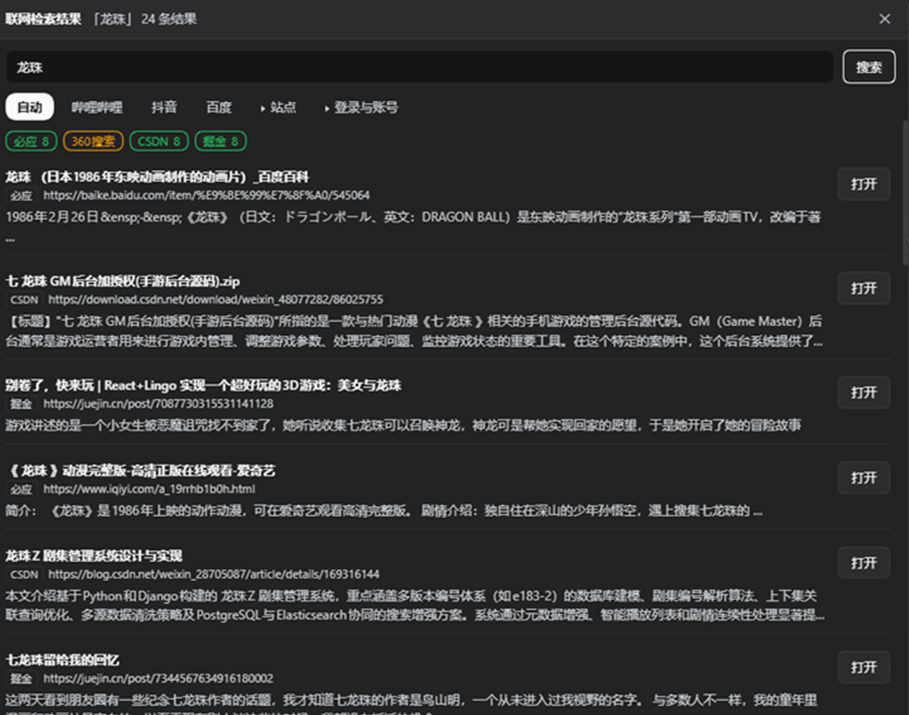
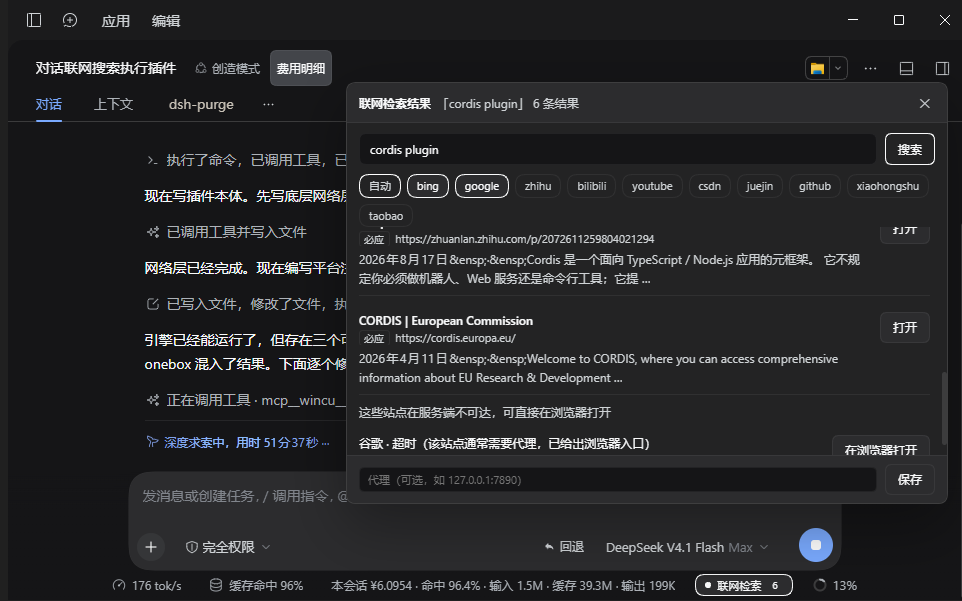
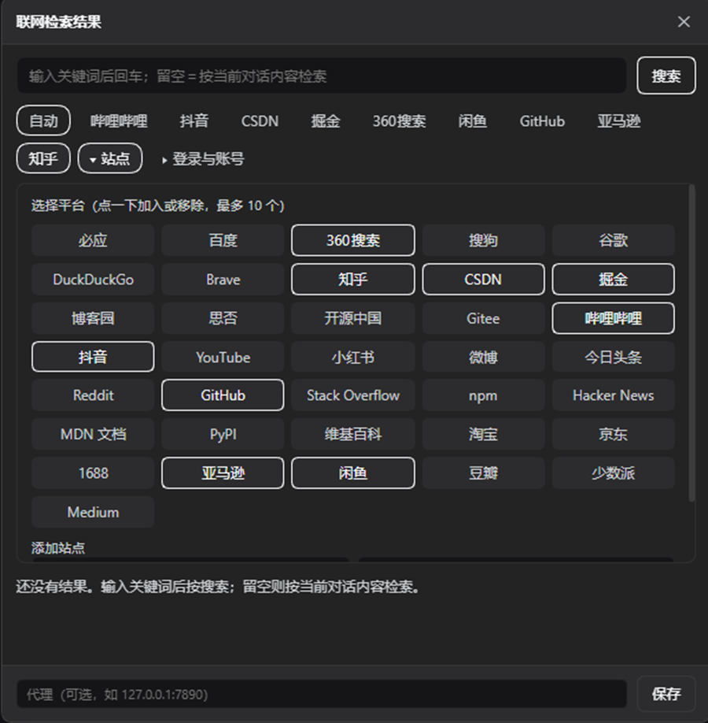
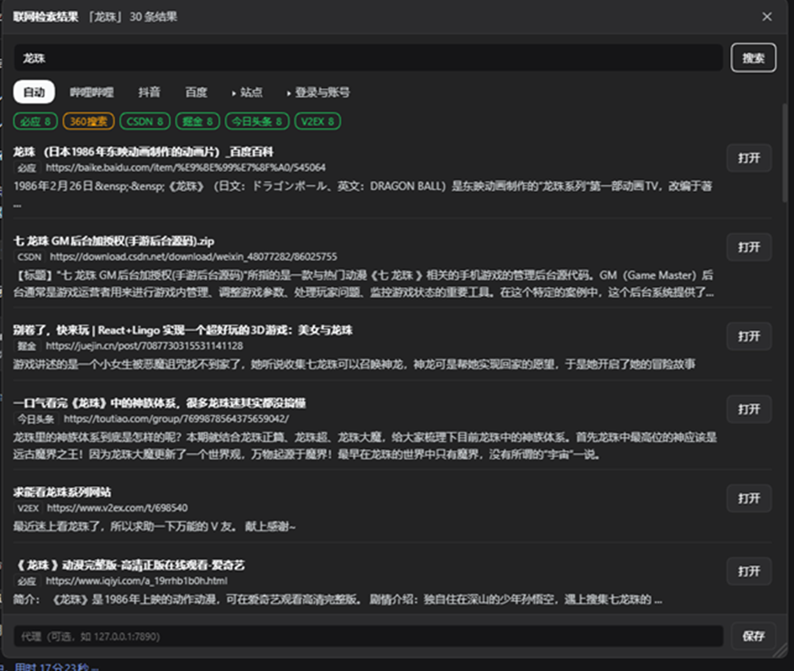
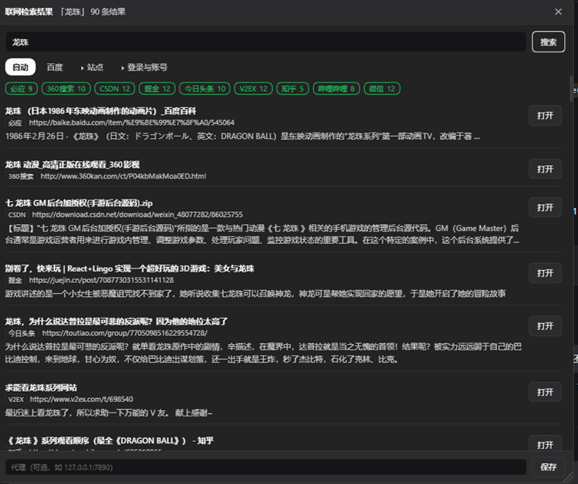
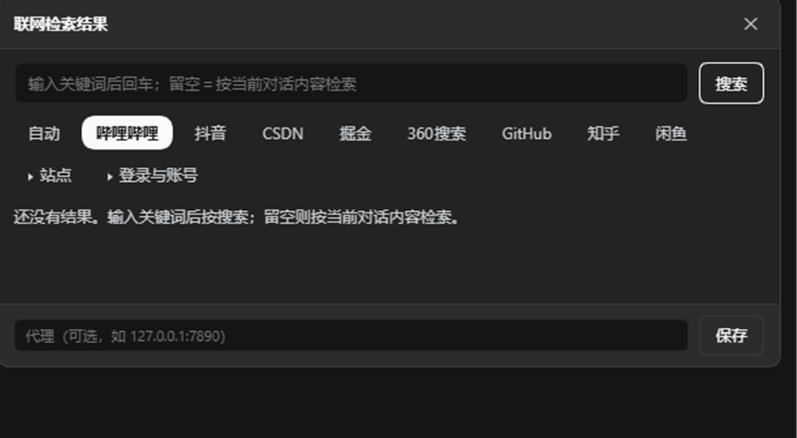
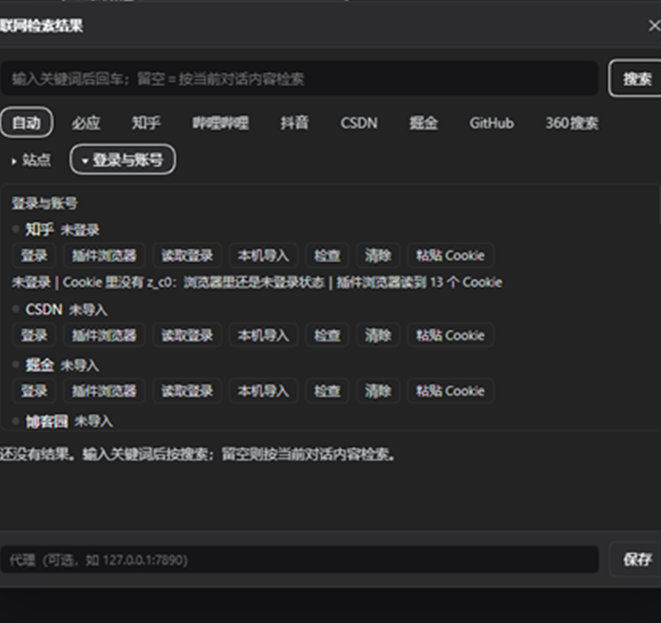

# web-scout · DeepSeek Harness 联网检索插件

> 按对话内容自动联网检索，41 个平台后端，站内搜索、登录态复用、可拖动缩放的结果面板。
> A conversation-aware web search plugin for [DeepSeek Harness](https://github.com/deepseek-ai) (Cordis bundle). 41 platform backends, native in-site search, cookie-based login reuse, a draggable/resizable result panel.


---

## 这是什么

一个 DSH（DeepSeek Harness）插件。装好之后：

1. **输入框下方多一个「联网检索」挂件**：点开面板，输入关键词或直接留空（留空就用当前对话内容当查询），搜完在面板里看结果。
2. **给 Agent 三个工具**：`web_scout_search`（搜）、`web_scout_open`（在系统浏览器打开）、`web_scout_read`（读网页正文）。模型在对话里会自己调用它们。
3. **一个 HTTP 接口**：`POST /web-scout/api`，把检索能力暴露给任何本地脚本。

不需要 API Key，不依赖任何第三方搜索服务的付费额度：能直连的就直连（必应、360、CSDN、掘金、今日头条、V2EX、哔哩哔哩、微信…），拿不到接口的站点走 `site:` 检索兜底，并在末尾给一条「站内搜索入口」。

| 面板：结果与平台状态 | 不可达站点给浏览器入口 |
| --- | --- |
|  |  |

| 站点与登录（可收放分区） | 站内后端（今日头条 / V2EX） |
| --- | --- |
|  |  |

| 一次 90 条（v1.6 多页抓取） | 芯片选中态（实心白胶囊） |
| --- | --- |
|  |  |

| 登录与账号（7 个按钮） | 抖音热榜（无需关键词） |
| --- | --- |
|  |  |

## 功能

- **41 个平台**：4 类后端——直连接口（JSON/HTML 解析）、`site:` 站内检索（必应 + 360 双引擎，带域名校验）、榜单/信息流（抖音热榜、知乎推荐、知乎关注，不需要关键词）、自定义站点。
- **多页抓取**：`limit`（每源条数，≤30）× `pages`（每源页数，≤4）× `maxPlatforms`（同时跑几个源，≤14）。默认 `12 × 3 × 10`，实测「龙珠」一次 70–90 条，`20 × 4` 可到 103–121 条。
- **相关性过滤**：标题和摘要都不含关键词的结果直接丢掉（修掉 B 站搜「龙珠」返回「赵云-飞龙神将」这类“猜词”噪音），过滤后为空会走一次 `site:` 兜底。
- **落地页过滤**：站点类平台不再把首页/频道页（`/`、`/hot`、`/search`、`/topic`）当结果返回。
- **跨源去重**：`utm_*`、`spm`、`from`、`ref` 等追踪参数会被剥掉再比对，同一篇文章不会在必应和知乎各出现一次。
- **对话感知**：留空查询时，从最近的对话里提取用户意图（自动跳过系统注入的噪音行），并识别「在B站和知乎搜一下」这种平台指名。
- **登录态复用**：插件自带一个独立 profile 的浏览器（`--user-data-dir`），你在里面登录一次，插件通过 CDP 读 cookie，之后搜索和读网页都带着你的登录态；也支持从 Edge/Chrome/Firefox 导入、手动粘贴。
- **面板可拖动、可缩放**，位置记在 `localStorage['web-scout-panel-rect']`；`打开` 交给系统默认浏览器。
- **纯 Node 实现，零运行时依赖**：不用 `npm install`，HTTP/TLS/压缩/WebSocket 全部用 `node:http`、`node:tls`、`node:zlib`、全局 `WebSocket`。

## 安装

### 前置

- DeepSeek Harness（桌面版即可），版本需支持 `plugin_manager` 的 bundle 安装。
- Node.js **≥ 22**（用到全局 `fetch`、`WebSocket`、`node:sqlite`）。
- 操作系统：Windows / macOS / Linux。登录用的浏览器是 Edge 或 Chrome（macOS 的 `/Applications`、Linux 的 `/usr/bin` 路径都已内置）。

### 方式 A：把仓库目录交给 plugin_manager（推荐）

```bash
git clone https://github.com/[GITHUB_OWNER]/web-scout.git D:/dshcs/web-scout
```

然后在 DSH 会话里让 Agent 执行：

```text
plugin_manager action=install_bundle target=D:/dshcs/web-scout
```

安装成功后 profile 的 `package.json` 会出现 `"@local/web-scout": "link:D:/dshcs/web-scout"`，`dsh.profile.bundles` 末尾多一项 `@local/web-scout`。

### 方式 B：手动改 profile（不推荐，容易出错）

参考 `plugin_manager` 的产物，只改两处：`dependencies` 加 `"@local/web-scout": "link:<仓库绝对路径>"`，`dsh.profile.bundles` 末尾追加 `"@local/web-scout"`，然后重启 DSH。

> 本包自带的 `cordis.patch.yml`（一行 `insert`，id `web-scout`）由安装器读取，用来生成配置行 `include:web-scout`——**不要**把它手抄进 profile 的 `cordis.patch.yml`。同一个包在两个 Loader 源里出现会直接报 `client-modules: package @local/web-scout resolves from multiple active Loader sources`，那样客户端半永远加载不出来。

### 安装后必做两件事

1. **让客户端半进入引导图**：在 DSH 里执行
   ```text
   plugin_manager action=set_bundle target=@local/web-scout enabled=false
   plugin_manager action=set_bundle target=@local/web-scout enabled=true
   ```
   这一步触发 Host 重新扫描 `dsh.client`，把 `@local/web-scout` 写进 `window.__DSH_BOOT__`。**跳过这步，面板挂件不会出现。**
2. **刷新页面**（DevTools 里 `location.reload()`，或重启 DSH）。之后输入框下方应出现「联网检索」挂件。

### 验证

```text
POST http://127.0.0.1:3209/web-scout/api
{"op":"catalog"}
```

返回 `{"ok":true,...}` 且 `platforms` 长度为 41、`chips` 为 8 个默认芯片，就说明 Host 和客户端都已就绪。

离线验证（不启动 DSH，直接跑引擎）：

```bash
node scripts/smoke.mjs "cordis 插件"
```

## 使用

### 挂件

- 点「联网检索」打开面板；输入关键词回车，或直接点「搜索」（留空 = 用当前对话内容当查询）。
- 芯片行是平台选择：点一下加入、再点一下移除；「站点」分区里是所有平台的网格，还能新增任意站点（名称 / 限定域名 / 搜索地址，用 `{q}` 占位）；「登录与账号」分区管登录。
- 结果行左边的平台名来自后端标签，右边「打开」交给系统浏览器；服务端不可达的站点会单独列一块，每行一个「在浏览器打开」。

### 三个工具（Agent 侧）

| 工具 | 参数 | 用途 |
| --- | --- | --- |
| `web_scout_search` | `query?` `platforms?` `limit?` `pages?` `timeoutMs?` `context?` `open?` | 检索；`query` 省略时按对话内容推断 |
| `web_scout_open` | `url?` `platform?` `query?` | 用系统浏览器打开结果或该站的搜索页 |
| `web_scout_read` | `url` `maxChars?` | 抓正文（返回标题、正文、状态码、页内链接） |

### HTTP 接口

`POST http://127.0.0.1:3209/web-scout/api`，请求体 `{"op":"...", ...}`：

| op | 主要参数 | 说明 |
| --- | --- | --- |
| `catalog` | — | 平台清单 + 当前配置 + 芯片 + 登录状态 |
| `search` | `query?` `platforms?` `limit?` `pages?` `context?` `sessionId?` `open?` | 检索并记录历史 |
| `read` | `url` `maxChars?` | 抓网页正文 |
| `open` | `url?` `platform?` `query?` | 系统浏览器打开 |
| `config` | `patch:{}` | 改代理 / 条数 / 默认平台等 |
| `chips` | `chips:[]` | 保存芯片条 |
| `platform.add` / `platform.remove` | `{name,url,site}` / `{id\|name}` | 自定义站点 |
| `login.open` `login.browser` `login.capture` `login.import` `login.paste` `login.check` `login.clear` `login.status` | `platform` | 登录相关（见下） |
| `browser.status` | — | 插件自管浏览器状态 |
| `graph` | — | 自检：客户端包是否已进入 `__DSH_BOOT__` |
| `history` / `clear` | — | 检索历史 |

## 平台与后端

**直连后端**（不经过搜索引擎，直接拿站内数据）：

| 平台 | 后端 | 翻页 | 备注 |
| --- | --- | --- | --- |
| 必应 | `bing` | ✗ | HTML 解析，恒定 10 条 |
| 百度 | `baidu` | `pn` | 反爬较凶，失败会降级为浏览器入口 |
| 360搜索 | `so360` | `pn` | 结果真链接在 `data-mdurl` |
| 搜狗 | `sogou` | ✗ | 同上，验证码会降级 |
| 谷歌 / DuckDuckGo / Brave | `google` / `ddg` / `brave` | — | 需要代理，否则直接给浏览器入口 |
| CSDN | `csdn` | `p` | JSON 接口 |
| 掘金 | `juejin` | `cursor` | POST + 游标，19 条/页 |
| 哔哩哔哩 | `bilibili` | `page` | WBI 签名，两字关键词有“猜词”问题已被相关性过滤挡住 |
| 知乎 | `site:zhihu.com` | — | 登录后可用 `/api/v3/feed` 读首页（本插件只做检索） |
| 今日头条 | `toutiao` | ✗ | 解析 SSR 页面里的 `<script type="application/json">` |
| V2EX | `v2ex` | `from` | `sov2ex` 接口 |
| 微信 | `weixin` | `page` | 搜狗微信，抓公众号文章标题/摘要/账号 |
| 抖音热榜 | `douyin-hot` | ✗ | 榜单，不需要关键词，50 条 |
| 知乎推荐 | `zhihu-recommend` | `page_number` | **需要登录**；首页推荐流，6 条/页 |
| 知乎关注 | `zhihu-follow` | `page_number` | **需要登录**；关注流，6 条/页 |
| GitHub / Stack Overflow / npm / Hacker News / 维基百科 | 各自接口 | `page` | Stack Overflow 与维基需要代理 |

**站内检索**（`site:` 双引擎兜底，带域名校验、过滤首页）：知乎、博客园、思否、开源中国、Gitee、抖音、小红书、微博、Reddit、MDN、PyPI、淘宝、京东、1688、亚马逊、闲鱼、豆瓣、少数派、Medium、YouTube。

> 加新平台的成本：能直连就在 `engines.js` 的 `BACKENDS` 里加一个 `async (ctx) => rows`，再在 `PLATFORM_LIST` 里挂 `backend`；不能直连就在 `PLATFORM_LIST` 里给个 `site` + `browser(q)`，其余全部自动生效（翻页、去重、过滤、状态药丸都不用管）。

### 信息流平台（v1.7）

「抖音热榜」「知乎推荐」「知乎关注」不消费关键词——选中它们、输入框留空直接搜，拿到的就是当前榜单/信息流。

- 抖音热榜：`iesdouyin` 榜单接口，50 条，带排名/热度/标签位。
- 知乎推荐 / 知乎关注：`/api/v3/feed/topstory*`，6 条/页，`pages` 控制翻几页。**必须先登录知乎**，否则状态药丸会显示「需要登录：还没登录知乎…」。
- 这三个平台不在默认 9 源里（混进关键词检索会全是噪音），需要时在「站点」分区里点一下加到芯片条。
- 只选信息流平台时，插件不会把对话内容硬塞成查询词（`feedOnly` 分支），API 用 `{"op":"search","platforms":["zhihufollow"]}` 即可。

## 登录状态

插件的检索和读页面都用同一个 cookie jar，所以「搜到的内容和你浏览器里看到的一样」取决于有没有登录态。

| 入口 | 做什么 | 前提 |
| --- | --- | --- |
| **插件浏览器**（推荐） | 用独立 profile 拉起 Edge/Chrome，通过 CDP 读 cookie | 无需关浏览器 |
| 本机导入 | 读 Edge/Chrome/Firefox 的 cookie 数据库 | **必须先关掉浏览器**（库被独占锁） |
| 粘贴 Cookie | 手动粘 `SESSIONID=...; z_c0=...` | 需要知道 cookie 名 |
| 检查 / 清除 | 用站点探针校验、或清空该站 cookie | — |

登录判定不只看「有没有 cookie」：哔哩哔哩要 `SESSDATA`、知乎要 `z_c0`、GitHub 要 `user_session`/`logged_in`，只有匿名 cookie 会明确告诉你「浏览器里还是未登录状态」。

Cookie 存在 `~/.dsh/web-scout.json` 的 `cookies` 字段里，**不要提交到 git**（`.gitignore` 已排除 `web-scout.json`、`session.json`）。

## 配置

配置文件：`~/.dsh/web-scout.json`（`DSH_PROFILE_DIR` 存在时在 `<profile>/web-scout.json`）。也可用面板底部或 `op:"config"` 改。

| 字段 | 默认 | 说明 |
| --- | --- | --- |
| `proxy` | `''` | HTTP 代理，`127.0.0.1:7890` 或完整 URL；空 = 直连 |
| `limit` | `12` | 每个平台返回条数（≤30） |
| `pages` | `3` | 每个平台抓几页（≤4） |
| `maxPlatforms` | `10` | 同时跑几个平台（≤14） |
| `timeoutMs` | `12000` | 单平台超时（3–30 秒） |
| `defaultPlatforms` | 9 个 | `auto` 的真实底座：必应、360、CSDN、掘金、今日头条、V2EX、知乎、哔哩哔哩、微信 |
| `chips` | 8 个 | 面板上的芯片条 |
| `autoOpen` | `false` | 搜完是否自动打开第一条 |
| `customPlatforms` | `[]` | 自定义站点（`{id,name,url,site}`，≤24 条） |
| `cookies` / `accounts` | `{}` | 登录态与校验结果 |

## 代理

默认直连。国内直连能用的有：必应、360、百度、搜狗、CSDN、掘金、哔哩哔哩、今日头条、V2EX、微信、抖音热榜。需要代理的是：谷歌、DuckDuckGo、Brave、YouTube、Reddit、Stack Overflow、维基百科、PyPI、亚马逊、Medium。

打开 TUN/系统代理不会自动生效——本插件走自己的 HTTP 客户端，请在面板底部填代理地址（或 `op:"config"` 写 `proxy`）。填了之后所有平台（含站点内检索）都走这个代理。

## 常见问题

**装好了但没看到挂件？**
客户端半要出现在 `window.__DSH_BOOT__` 里才会加载。执行一次 `plugin_manager set_bundle target=@local/web-scout enabled=false` 然后 `enabled=true`，再 `location.reload()`。可以用 `POST /web-scout/api {"op":"graph"}` 自检：`has:true, composed:true` 才算进图。

**改了 Host 代码不生效？**
`index.js` / `api.js` / `engines.js` / `store.js` 属于 Host 半，改完必须 `set_bundle` 关开一次；`client.js` 由 `dsh-hmr` 自动发版，但页面要刷新才能看到。

**某个平台一直 `blocked`？**
360 / 搜狗 / 百度会按 IP 出验证码，表现为 `blocked` + 浏览器入口，过几分钟自动恢复。需要稳定结果就给代理，或只留必应这类温和的源。

**面板一片空白、结果 0 条？**
先看状态药丸：全是红的说明网络不通（检查代理），只有某个平台红说明是那个平台的问题。用 `node scripts/smoke.mjs 你的关键词` 可以直接看到每个平台的返回码与耗时。

**搜出来的结果很少？**
三个开关：`limit`（每源条数）、`pages`（翻页数）、`maxPlatforms`（参与源数）。默认 `12/3/10`；拉到 `20/4/14` 大约能到 100–120 条（更多源不一定更好，噪音也会变多）。

**「知乎推荐」显示需要登录？**
知乎信息流走后端接口，必须有 `z_c0` 登录 cookie。点「登录与账号 → 插件浏览器」登录一次，再点「读取登录」；用「本机导入」也行，但要先关掉浏览器（cookie 库被独占锁）。

**安全吗？**
插件只做三件事：发 HTTP 请求、起一个独立 profile 的浏览器读 cookie、用系统默认浏览器打开链接。没有遥测，不上传任何数据；cookie 只存在本地配置文件里。

## 架构

```
web-scout/
├── index.js          Host 入口：注册 3 个工具 + systemPrompt + /web-scout/api 路由 + 客户端自愈
├── api.js            接口分发（catalog/search/read/open/config/chips/platform.*/login.*/browser.*/graph）
├── engines.js        41 个平台定义 + 各站后端 + 翻页/去重/相关性过滤/站内兜底
├── net.js            零依赖 HTTP 客户端（手动重定向、gzip/br/zstd、GBK、CONNECT 隧道、CookieJar）
├── store.js          配置持久化（原子写、防抖、版本迁移）
├── login.js          登录探针与判定（require 白名单）
├── browserCookies.js 本机浏览器 cookie 导入（Chromium / Firefox）
├── browserAuth.js    插件自管浏览器（CDP 读 cookie）
├── open.js           系统默认浏览器打开
├── client.js         面板挂件（React，内联样式，portal 到 body）
├── locale/           zh.json / en.json
├── scripts/smoke.mjs 离线冒烟测试
└── docs/             截图
```

数据流：挂件 `fetch('/web-scout/api')` → `api.js` 分发 → `engines.js` 用 `net.js` 抓 → 汇总去重 → 返回 JSON → 面板渲染；工具调用走同一条链路（`index.js` 里包了一层 `output.render`）。

## 开发

```bash
node --check index.js              # 语法检查
node scripts/smoke.mjs 龙珠         # 离线跑引擎
curl -s -X POST http://127.0.0.1:3209/web-scout/api \
  -H 'content-type: application/json; charset=utf-8' \
  -d '{"op":"search","query":"龙珠","platforms":["auto"],"limit":8}'
```

改 Host 半后：`set_bundle` 关开一次。改 `client.js` 后：刷新页面。日志看 DSH 主进程输出，插件侧的问题会带 `web-scout:` 前缀。

## 发布到 GitHub

```bash
cd D:/dshcs/web-scout
git init
git add .
git commit -m "feat: web-scout 1.7.0 — 41 平台联网检索插件"
git branch -M main
git remote add origin https://github.com/[GITHUB_OWNER]/web-scout.git
git push -u origin main
```

发布前记得替换占位符：`package.json` 的 `author` / `repository` / `homepage` / `bugs`，`LICENSE` 的版权人，本 README 里的 `[GITHUB_OWNER]`。

**不要提交**：`~/.dsh/web-scout.json`（含登录 cookie）、`web-scout-browser/`（浏览器 profile）、`_probe/`（调试脚本）。`.gitignore` 已处理。

## 许可

[MIT](LICENSE)